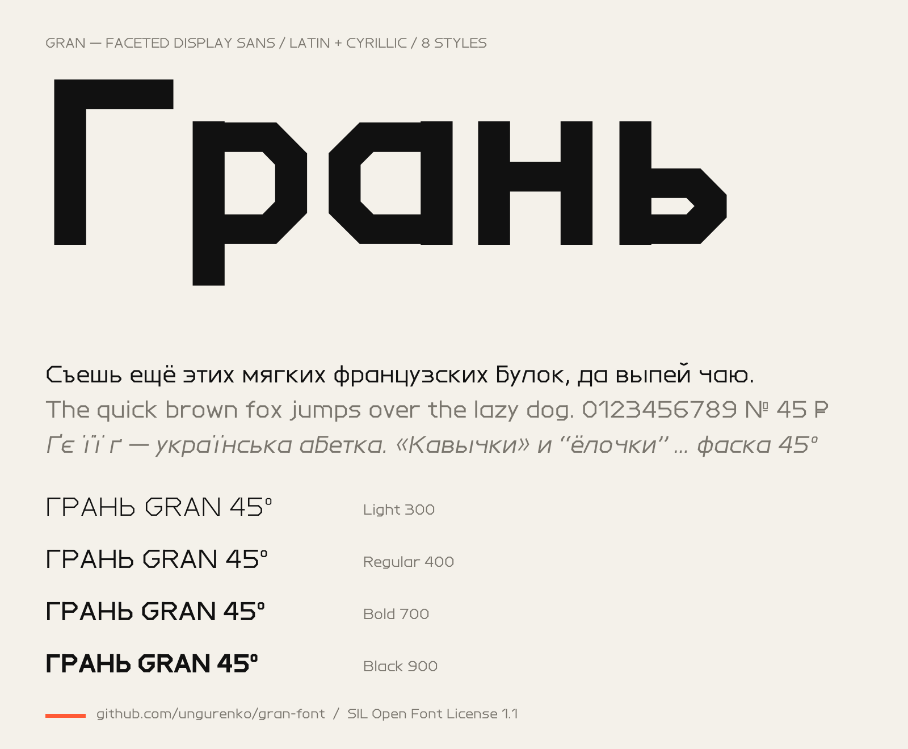
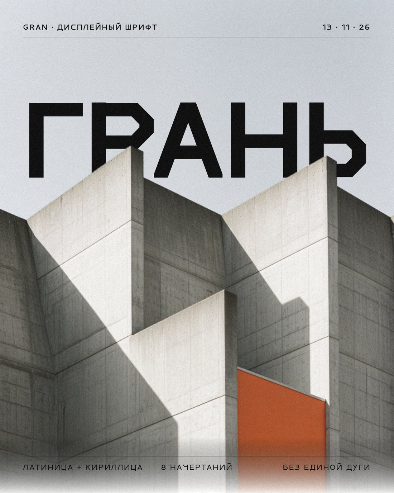
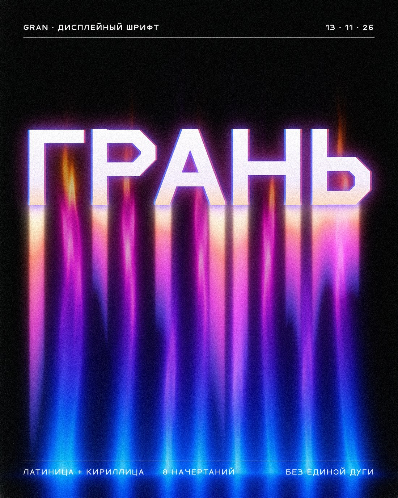

<div align="center">

# Gran · Грань

**A display sans with no curves: every round shape is cut by straight 45° facets.**

Latin & Cyrillic · 8 styles · 184 glyphs per style · SIL Open Font License 1.1

[](OFL.txt)
[](https://github.com/ungurenko/gran-font/releases)
[](#styles)



</div>

---

## 🎯 What it is

*Грань* means "facet" in Russian, and everything in the typeface follows from that word. There is not a single arc in
it: every curve is replaced by straight cuts at 45°, so O turns into an octagon, and the counters of Б, В and Я are
built from the same straight pieces as the Latin ones.

- **8 styles** — Light 300, Regular 400, Bold 700, Black 900, each upright and oblique
- **Two alphabets** — Latin and Cyrillic, including the Ukrainian letters Ґ Є І Ї
- **Three formats** — OTF, TTF and WOFF2 for every style, plus UFO sources for the upright weights
- **Original** — drawn from scratch as centre-line skeletons, no third-party glyphs or fonts used as a base

It is a display face: headlines, covers, logos, posters, big numbers, video titles. Paragraphs work from 18 px in
Regular or Light. Bold and Black are for large sizes only.

## 🖋 Styles

| Style | Vertical stroke | usWeightClass | Family name (ID 1) | Typographic (ID 16 / 17) |
| --- | --- | --- | --- | --- |
| `Gran-Light` | 56 | 300 | `Gran Light` | `Gran` / `Light` |
| `Gran-Regular` | 78 | 400 | `Gran` | |
| `Gran-Bold` | 100 | 700 | `Gran` | |
| `Gran-Black` | 134 | 900 | `Gran Black` | `Gran` / `Black` |

Every weight has an oblique: 10° of shear, `italicAngle -10`. It is the upright shape slanted, not a drawn italic — a
deliberate choice, the concept has no calligraphic forms at all. Outer edges, glyph widths and heights stay the same
across weights; only stroke width and a small spacing factor change (lighter weights get more air).

## 🚀 Install

### On a computer

Download the [latest release](https://github.com/ungurenko/gran-font/releases) and open `Gran-<Style>.otf` or `.ttf`
with Font Book (macOS) or double-click it on Windows. Restart the app that was open while installing; on macOS all
eight styles then group under one family, **Gran**.

Canva (Pro) accepts an OTF upload. Google Docs can't install fonts at all, and Figma in a browser only sees local fonts
through its desktop app — for those, use the web setup below.

### On the web

Grab the `.woff2` files you need (each style is a separate file) and add one `@font-face` per style:

```css
@font-face {
  font-family: "Gran";
  src: url("Gran-Regular.woff2") format("woff2");
  font-weight: 400;
  font-style: normal;
}
@font-face {
  font-family: "Gran";
  src: url("Gran-BlackItalic.woff2") format("woff2");
  font-weight: 900;
  font-style: italic;
}
```

`test/gran.css` already has all eight `@font-face` rules, weights 300 400 700 900, upright and italic.

### In Figma, Photoshop, Illustrator

Install the OTF files into the system fonts (the desktop apps read local fonts), or drop `dist/Gran-*.ufo` into a
font editor to work on the outlines.

## 🖼 In use

Posters set in Gran over generated backgrounds. The word is always real type, never AI-drawn text: the model does the
background, the letters are laid out in HTML/canvas.

|  |  |
| --- | --- |
| **Concrete** — Brutalist slab, Black type | **Risograph** — two inks on cream, multiply |
|  |  |
| **Blueprint** — Cobalt technical drawing, Light | **Neon** — Dark HUD glow, Black type |

The recipes live in [`posters/`](posters/README.md): an HTML template plus the prompt that made each background.

## 📦 What's inside

```
gran-font/
├── dist/          24 binaries (OTF, TTF, WOFF2) + 4 UFO sources
├── src/glyphs.py  glyph skeletons — the real source of the design
├── src/build.py   skeleton → outline → OTF / TTF / WOFF2 / UFO
├── test/          specimen pages and @font-face CSS
├── posters/       poster recipes
└── OFL.txt        licence
```

| File | What |
| --- | --- |
| `src/glyphs.py` | Glyph skeletons for every character; each shape is a centre line plus a stroke width |
| `src/build.py` | Warps skeletons per weight, builds outlines, writes all formats and the name/OS2 tables |
| `test/index.html` | Main test page: family, specimens, sizes, rhythm, kerning, your own text |
| `test/chart.html` | Every glyph at 100 px with guides, a button per style (`?s=0..7`) |
| `test/formats.html` | OTF, TTF and WOFF2 side by side |
| `test/display.html` | Large display samples |
| `test/gran.css` | `@font-face` for the whole family |
| `posters/README.md` | How a poster is put together, with the prompt behind each background |

## 🔨 Rebuild

```bash
python3 -m venv .venv
.venv/bin/pip install shapely fonttools brotli
.venv/bin/python src/build.py
```

The script rebuilds all 8 styles into `dist/` and prints glyph counts and file sizes per style. Glyphs are edited only
in `src/glyphs.py`.

## 🔤 Coverage

184 glyphs per style:

- Basic Latin, all 94 printable ASCII characters
- Russian А–Я, а–я, Ё, ё; Ukrainian Ґ, Є, І, Ї and their lowercase forms
- Digits, `« » “ ” ‘ ’ – — … • № € ₽ °`
- Pair kerning (`kern` feature, GPOS) for diagonal letters and Cyrillic pairs, scaled with the spacing factor

Not included: Greek, Latin Extended, Cyrillic Extended, combining marks, and the middle dot `·` (use `•` or `—`).

## 📐 Metrics

Units per em 1000. Cap height 700, x-height 520, ascender 720, descender 170 (feet and tails).
hhea 950 / −250, typo 800 / −200 with 200 gap, win 950 / 250. No hinting; `gasp` asks for smooth rendering.

## ✅ Checked

- OTS, the sanitizer browsers use, accepts all 24 files.
- OTF and TTF outlines match for every glyph in every style (area, bounds, advance).
- Bold is unchanged by the weight work: 0 differences against v0.2.
- A Chromium browser loads all styles as one CSS family and renders them.

## ⚠️ Known limits

An honest list, because a font that hides its gaps is worse than one that names them.

- Outlines are straight segments (degree-1 Béziers) — the concept has no curves at all.
- The oblique is a shear of the upright: no true Cyrillic italic forms such as д and т.
- No TrueType hinting, so Windows GDI at small sizes is unchecked.
- Latin Extended, Cyrillic Extended, combining marks and Greek are missing.
- A small set of kerning pairs, tuned by eye on Bold. No kerning classes; Light and Black are not tuned separately.
- Not tested in Photoshop, Illustrator, Figma, Word or on Windows.
- `I`, `l` and `|` share one plain stem and differ by height only (`l` is 20 units taller).

## 📄 Licence

SIL Open Font License 1.1 — see [OFL.txt](OFL.txt). In short: use it free of charge, including commercially, embed it
in apps and on websites, modify and redistribute it; don't sell the font files on their own, and derivative fonts must
stay under the same licence. The licence is also written into the name table of every file.

## 👤 Author

Alexander ([@ungurenko](https://github.com/ungurenko)) — design and the code that draws it. Issues and pull requests
are welcome; for a new glyph or a fixed pair, say which style and what is wrong.
