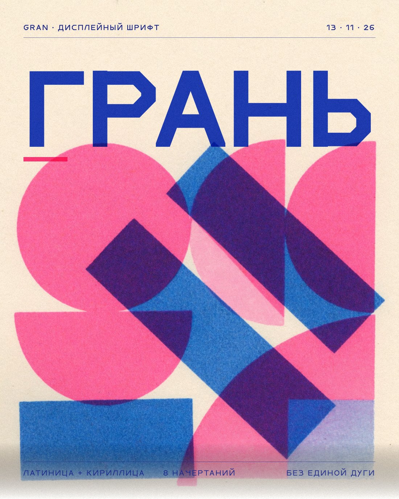
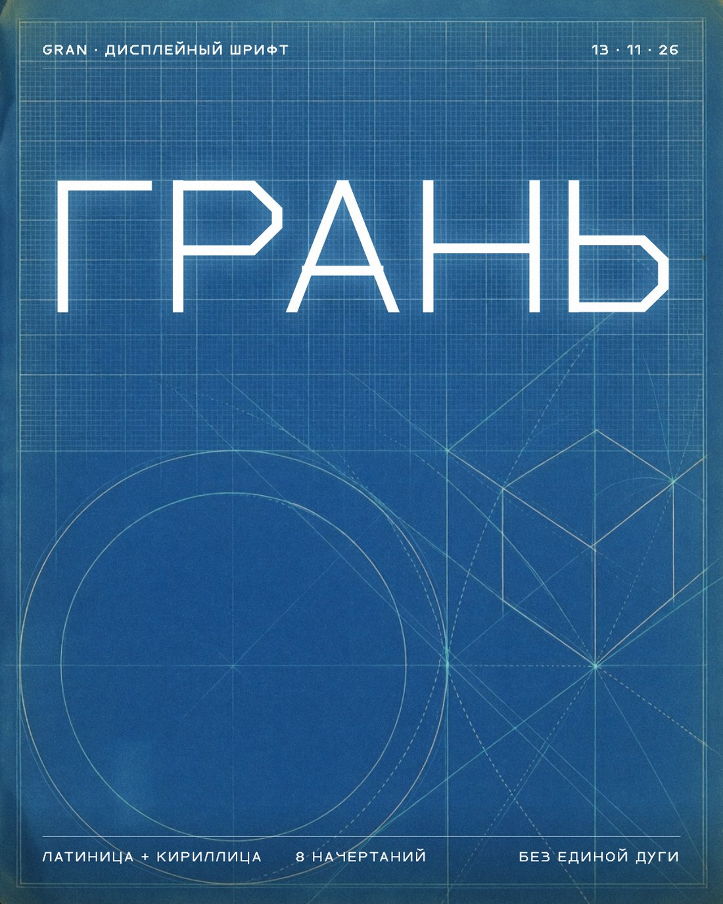

<div align="center">

# Gran · Грань

**Дисплейный гротеск без дуг: каждое скругление срезано фаской под 45°.**

Латиница и кириллица · 8 начертаний · 184 глифа в каждом · свободная лицензия SIL OFL 1.1

[](OFL.txt)
[](https://github.com/ungurenko/gran-font/releases)


</div>

---

## 🎯 Что это

«Грань» — дисплейный гротеск, в котором нет ни одной дуги. Каждое скругление заменено прямыми фасками под 45°: буква О превращается в восьмиугольник, просветы у Б, В и Я собраны из тех же прямых кусков, что и латиница.

- **8 начертаний** — Light 300, Regular 400, Bold 700, Black 900, каждое прямое и наклонное.
- **Два алфавита** — латиница и кириллица, включая украинские Ґ Є І Ї.
- **Три формата** — OTF, TTF и WOFF2 для каждого начертания, плюс исходники UFO для прямых.
- **Оригинальный рисунок** — глифы построены с нуля по осевым линиям, чужие шрифты за основу не брались.

Шрифт дисплейный: заголовки, обложки, логотипы, афиши, крупные цифры, титры в видео. Абзацы он держит от 18 px в Regular или Light, Bold и Black остаются для крупного кегля.

## 🖋 Начертания

| Начертание | Вертикальный штрих | usWeightClass | Имя семейства (ID 1) | Типографское (ID 16 / 17) |
| --- | --- | --- | --- | --- |
| `Gran-Light` | 56 | 300 | `Gran Light` | `Gran` / `Light` |
| `Gran-Regular` | 78 | 400 | `Gran` | |
| `Gran-Bold` | 100 | 700 | `Gran` | |
| `Gran-Black` | 134 | 900 | `Gran Black` | `Gran` / `Black` |

У каждого начертания есть наклонное: сдвиг 10°, `italicAngle -10`. Наклонное — это скошенное прямое, отдельный курсив не рисовался: в концепции нет каллиграфии. Внешние края, ширины и высоты знаков совпадают у всех начертаний, меняются толщина штриха и небольшой коэффициент разрядки: светлые начертания дышат свободнее.

## 🚀 Установка

### На компьютер

Скачай [последний релиз](https://github.com/ungurenko/gran-font/releases) и открой файл `Gran-<Начертание>.otf` или `.ttf` в Font Book на macOS либо двойным щелчком на Windows. После установки перезапусти программу, которая уже была открыта: на macOS все восемь начертаний собираются в одно семейство **Gran**.

Canva (Pro) принимает OTF загрузкой. Google Docs устанавливать шрифты не умеет, а Figma в браузере видит локальные шрифты только через своё настольное приложение. Для них подойдёт подключение для веба ниже.

### Для веба

Возьми нужные файлы `.woff2` (каждое начертание лежит отдельным файлом) и добавь по одному `@font-face` на начертание:

```css
@font-face {
  font-family: "Gran";
  src: url("Gran-Regular.woff2") format("woff2");
  font-weight: 400;
  font-style: normal;
}

@font-face {
  font-family: "Gran";
  src: url("Gran-BlackItalic.woff2") format("woff2");
  font-weight: 900;
  font-style: italic;
}
```

В `test/gran.css` уже лежат все восемь правил `@font-face`: веса 300, 400, 700 и 900, прямые и наклонные.

### Для Figma, Photoshop, Illustrator

Установи файлы OTF в системные шрифты: настольные программы видят локальные шрифты. Для работы с контурами положи `dist/Gran-*.ufo` в редактор шрифтов.

## 🖼 В работе

Афиши, набранные «Гранью» поверх сгенерированных фонов. Слово всегда настоящее, набрано шрифтом: модель рисует фон, буквы расставляются в HTML и canvas.

|  |  |
| --- | --- |
| **Бетон** — брутальная плита, чёрные буквы Black | **Рисограф** — два цвета на кремовой бумаге, multiply |
|  |  |
| **Чертёж** — кобальтовый ватман, светлые буквы Light | **Неон** — тёмный HUD со свечением, буквы Black |

Рецепты лежат в папке [`posters/`](posters/README.md): шаблон на HTML и промпт, которым сделан каждый фон.

## 📦 Что внутри

```
gran-font/
├── dist/          24 файла (OTF, TTF, WOFF2) и 4 исходника UFO
├── src/glyphs.py  осевые линии глифов — настоящий исходник рисунка
├── src/build.py   осевые → контур → OTF / TTF / WOFF2 / UFO
├── test/          тестовые страницы и CSS с @font-face
├── posters/       рецепты афиш
└── OFL.txt        лицензия
```

| Файл | Что это |
| --- | --- |
| `src/glyphs.py` | Осевые линии каждого знака: форма — это центральная линия плюс толщина штриха |
| `src/build.py` | Раздвигает осевые линии под вес, строит контуры, пишет все форматы и таблицы name и OS2 |
| `test/index.html` | Главная тестовая страница: семейство, образцы, кегли, ритм, кернинг, свой текст |
| `test/chart.html` | Все глифы по 100 px с направляющими, кнопка на каждое начертание (`?s=0..7`) |
| `test/formats.html` | OTF, TTF и WOFF2 рядом |
| `test/display.html` | Крупные образцы |
| `test/gran.css` | `@font-face` на всё семейство |
| `posters/README.md` | Как собирается афиша, с промптами фонов |

## 🔨 Пересборка

```bash
python3 -m venv .venv
.venv/bin/pip install shapely fonttools brotli
.venv/bin/python src/build.py
```

Скрипт пересобирает все восемь начертаний в `dist/` и печатает по каждому число глифов и размер файлов. Глифы правятся только в `src/glyphs.py`.

## 🔤 Покрытие

184 глифа в каждом начертании:

- базовая латиница, все 94 печатных символа ASCII;
- русские А–Я, а–я, Ё, ё; украинские Ґ, Є, І, Ї и их строчные;
- цифры, `« » “ ” ‘ ’ – — … • № € ₽ °`;
- парный кернинг (`kern`, GPOS) для диагональных латинских и кириллических пар, масштабируется вместе с разрядкой.

Чего нет: греческого, Latin Extended, Cyrillic Extended, комбинируемых знаков и точки посередине `·`. Вместо неё ставь `•` или `—`.

## 📐 Метрики

UPM 1000. Высота прописных 700, строчных 520, верх 720, низ 170 (ножки и хвосты). hhea 950 / −250, typo 800 / −200 с зазором 200, win 950 / 250. Хинтинга нет, `gasp` просит сглаженную отрисовку.

## ✅ Проверено

- OTS, санитайзер браузеров, принимает все 24 файла.
- Контуры OTF и TTF совпадают у каждого глифа в каждом начертании: площадь, границы, ширина.
- Bold не изменился при работе над весами: 0 отличий от v0.2.
- Браузер на Chromium грузит все начертания как одно семейство и рисует их.

## ⚠️ Ограничения

Честный список: шрифт, который прячет свои дырки, хуже шрифта, который их называет.

- Контуры — прямые отрезки (кривые Безье первой степени): в концепции нет дуг.
- Наклонное начертание — скошенное прямое, настоящих курсивных форм (д, т) нет.
- Хинтинга нет, поэтому мелкий кегль в Windows GDI не проверен.
- Latin Extended, Cyrillic Extended, комбинируемые знаки и греческий отсутствуют.
- Кернинга немного, он подобран на глаз по Bold. Классов кернинга нет, Light и Black отдельно не настроены.
- В Photoshop, Illustrator, Figma, Word и на Windows шрифт не проверялся.
- `I`, `l` и `|` — один прямой штрих, различаются высотой: `l` на 20 единиц выше.

## 📄 Лицензия

SIL Open Font License 1.1, текст в файле [OFL.txt](OFL.txt). Коротко: пользуйся бесплатно, в том числе в коммерческих проектах, встраивай в приложения и на сайты, меняй и раздавай. Продавать сами файлы шрифта нельзя, производные шрифты остаются под той же лицензией. Лицензия прописана в таблице name каждого файла.

## 👤 Автор

Александр ([@ungurenko](https://github.com/ungurenko)) — рисунок и код, который его строит. Issues и пул-реквесты приветствуются: если нужен новый глиф или сбита пара, напиши начертание и что именно не так.
